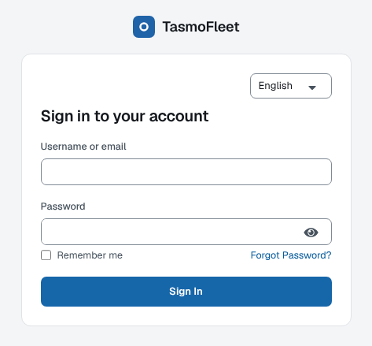
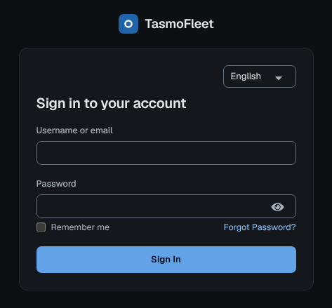
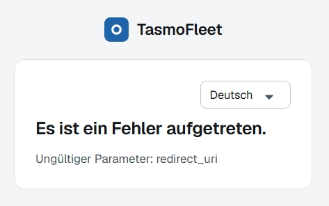
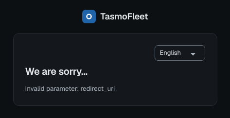
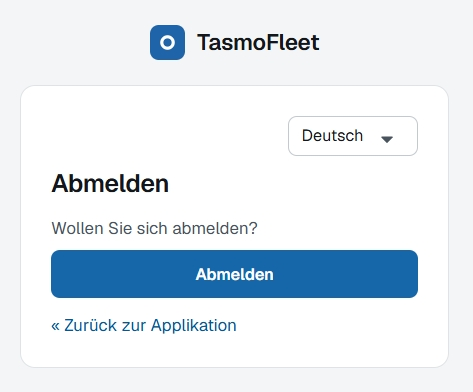
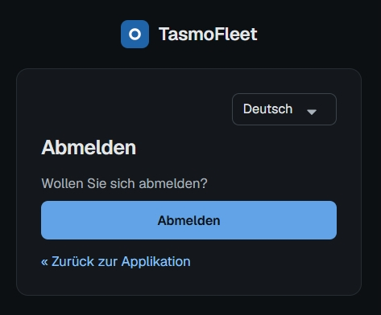

# tasmofleet-keycloak-theme

Custom Keycloak **login theme** in the visual identity of
[TasmoFleet](https://github.com/hellwand/tasmofleet).

> Unofficial community theme for TasmoFleet, not affiliated with the project.
> Design tokens, logo and favicon come from TasmoFleet release v0.36.1 (see NOTICE).
> Status: 0.1.0.

| Light | Dark |
|---|---|
|  |  |
|  |  |
|  |  |

## Scope

- Presentation only: no authentication logic, no changes to OIDC settings.
- Login theme only (no Admin Console, no Account Console).
- CSS-first on top of the parent theme `keycloak.v2` (PatternFly 5); no template overrides.
- Light and dark via system preference, responsive down to 375 px.
- Tokens, card metrics and fonts follow the TasmoFleet design system.
- Tested with Keycloak 26.8.2.

## Use it in a realm

1. Put the theme directory `tasmofleet` into `/opt/keycloak/themes/` (read-only volume), see
   [docs/deployment.md](docs/deployment.md).
2. Set in the realm: `loginTheme` = `tasmofleet` and `displayName` = `TasmoFleet`.
   The brand above the card is the realm's display name.

## Development

```bash
cd dev
docker compose up -d
# Admin Console: http://localhost:8040  (admin / admin, dev only)
# Login page:    http://localhost:8040/realms/tasmofleet/account
# Other port:    KC_DEV_PORT=8050 docker compose up -d
```

Theme caching is disabled in the dev setup, so CSS changes show up on reload.
The dev realm has the users `alice`, `bob` (must update password) and `carol`
(must set up OTP), the password equals the user name.

| Tool | Purpose |
|---|---|
| `dev/smoke-test.sh` | Automatic checks against the dev realm: theme active, assets, no external requests, security headers, invalid and successful sign-in with redirect, logout page |
| `dev/capture-pages.sh` | Saves the HTML of the login, error, logout, required-action and reset pages to `dev/snapshots/` (git-ignored) |
| `scripts/check-pf-vars.py` | Checks that every PatternFly variable the theme sets exists in a PatternFly release |
| `scripts/package.sh <version>` | Builds the release archive in `dist/` |

## Documentation

| Document | Content |
|---|---|
| [docs/requirements.md](docs/requirements.md) | Requirements and architecture (v0.3) |
| [docs/design-decisions.md](docs/design-decisions.md) | Open questions, decisions, tokens, accessibility audit, template overrides |
| [docs/deployment.md](docs/deployment.md) | Installation, caching, update, rollback |
| [docs/releasing.md](docs/releasing.md) | Branches, versioning, release steps |
| [docs/upgrading.md](docs/upgrading.md) | Checklist for Keycloak upgrades |
| [docs/testing.md](docs/testing.md) | Test checklists and status of the acceptance criteria |

## Related projects

| Project | Responsibility |
|---|---|
| [TasmoFleet](https://github.com/hellwand/tasmofleet) | Application and design system |
| Keycloak configuration (config-as-code) | Realm, clients, users, `loginTheme` selection |
| This repository | Login presentation |

## License

AGPL-3.0-or-later, see `LICENSE`. Chosen on purpose for software artefacts and because
TasmoFleet uses the same licence. Third-party components (Keycloak base themes, Geist fonts,
TasmoFleet design tokens) and their licences are listed in `NOTICE`.
